# Y2K Snake

> A retro LCD arcade snake game for iOS, built with SwiftUI and tuned for quick, tactile, high-score chasing sessions.


## Gameplay

<p align="center">
  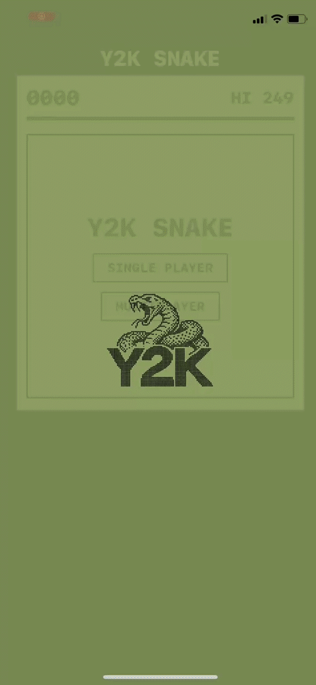
</p>

<p align="center">
  <a href="media/gameplay.MP4">Watch the full gameplay video</a>
</p>

## Play the Beta

Y2K Snake is currently available for public beta testing via TestFlight.

**TestFlight:** [Join the beta](https://testflight.apple.com/join/UpvqstTG)

---

## Overview

**Y2K Snake** is a modern reimagining of classic Snake, wrapped in the atmosphere of old LCD handhelds, early-2000s devices, and compact arcade sessions.

The game is designed around immediate readability: clean movement, sharp pixel-style UI, responsive on-screen controls, short runs, and a strong sense of tactile feedback through sound and haptics.

It currently includes several single-player modes and an early but playable **Multiplayer VS Snake** mode against an AI opponent. The project is actively developed and is currently in **TestFlight beta**.

---

## Screenshots

### Main Menu

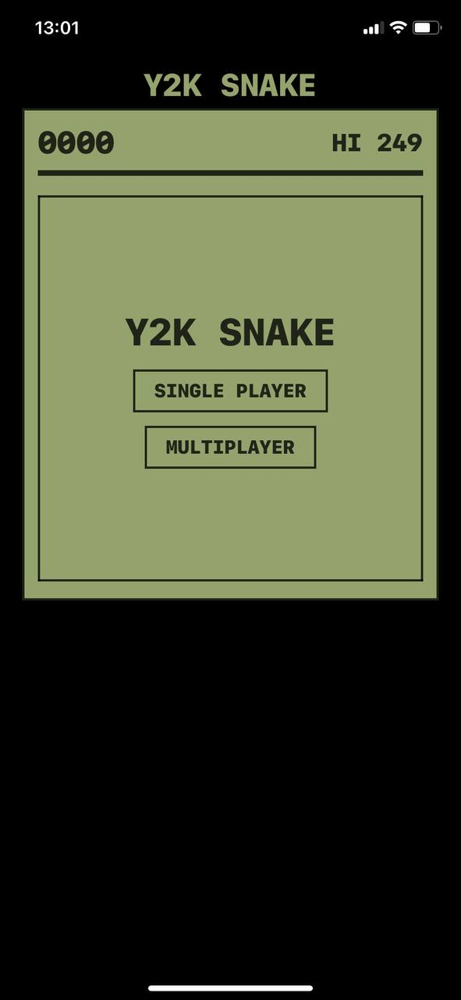

Choose between Single Player and Multiplayer from the retro handheld-style entry screen.

### Single Player

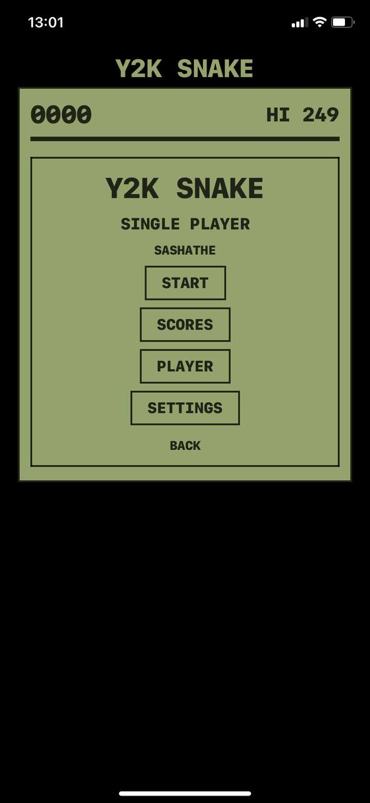

Start a run, browse scores, switch player profiles, or tune settings from the main single-player hub.

### Game Modes

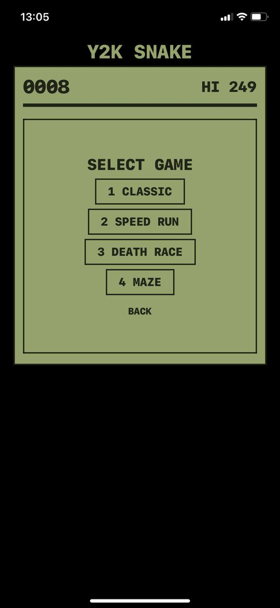

Pick from Classic, Speed Run, Death Race, and Maze modes before jumping into a run.

### Classic Gameplay

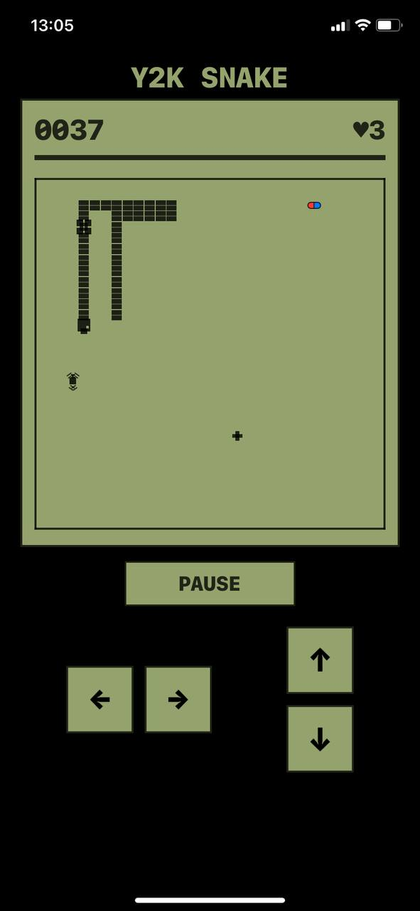

Classic Snake gameplay keeps the focus on clean movement, food chasing, and high-score pressure.

### Maze Gameplay

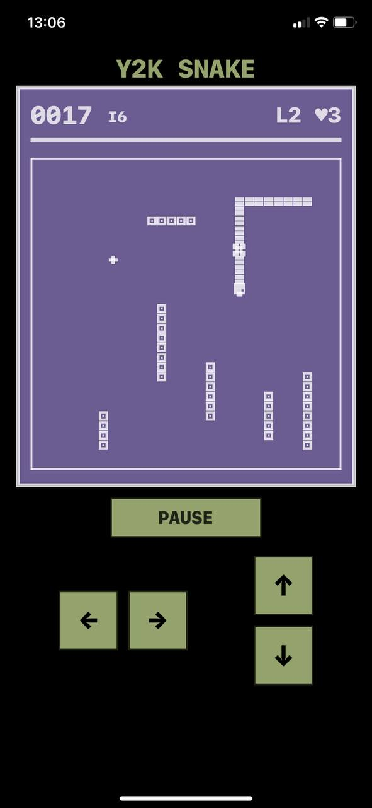

Maze mode adds wall layouts that turn each run into a tighter survival puzzle.

### VS Snake Gameplay

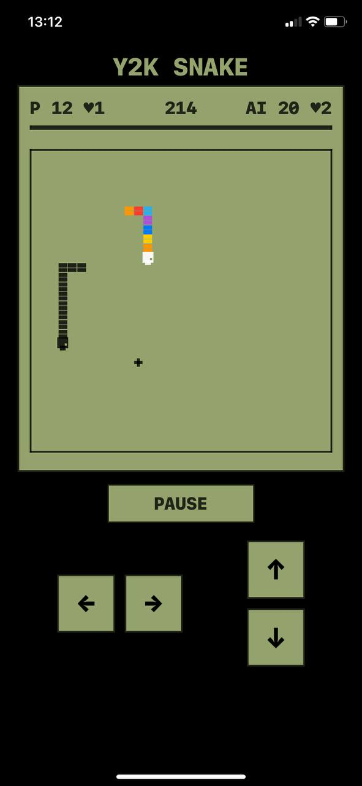

VS Snake brings a second snake onto the board for a Classic match against AI.

### VS Snake Victory

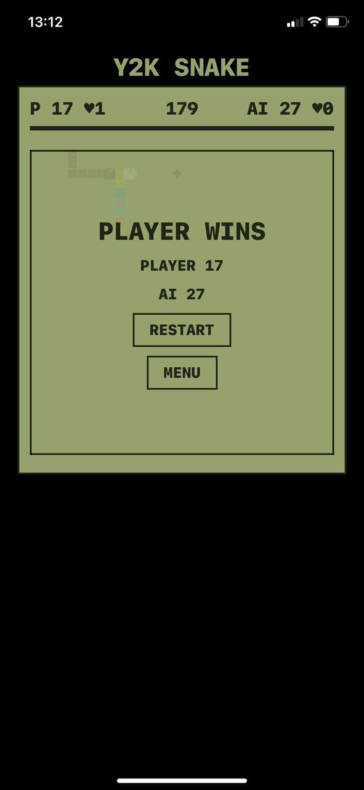

The match result screen shows the winner after a full Player-versus-AI round.

### Snake Skins

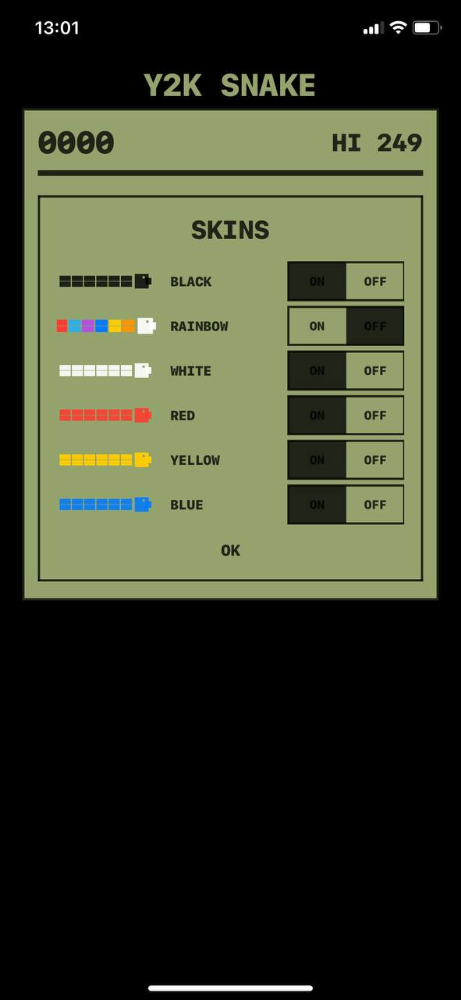

Player profiles can choose visual snake skins while preserving the LCD arcade look.

### Controls

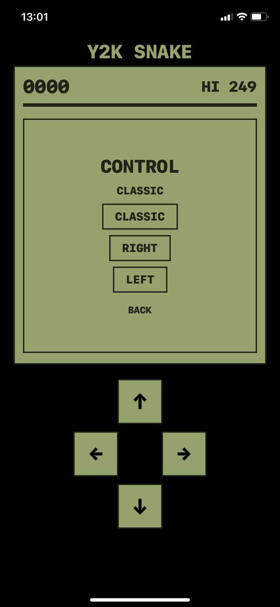

Control layouts can be previewed live in portrait and landscape before playing.

### Game Over

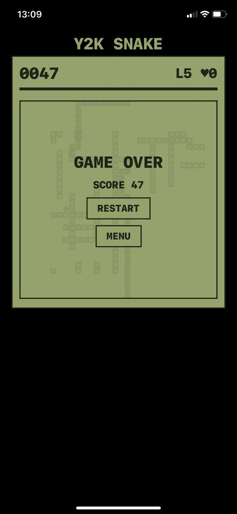

The game over screen keeps the end of a run clear, readable, and true to the retro UI style.

---

## Features

- 🎮 **Classic Snake**: traditional Snake with speed selection and lives.
- 🧱 **Maze Mode**: evolving wall layouts and level progression.
- ⚡ **Speed Run**: timed score chasing with pressure from the clock.
- ☠ **Death Race**: a survival-focused high-risk mode.
- 👥 **Multiplayer VS Snake**: Classic VS match against an AI-controlled snake.
- 🤖 **AI Snake**: Easy, Normal, and Hard difficulty profiles.
- 🕹 **Multiple Control Layouts**: Classic, Left, and Right control setups.
- 📱 **Portrait & Landscape Support**: responsive layout for different play styles.
- 📳 **Haptics**: tactile feedback for controls and key game moments.
- 🔊 **Retro Sound**: custom WAV-based SFX and menu music.
- 💾 **Persistent Profiles**: local player profiles, selected skins, controls, and scores.
- 🐍 **Snake Skins**: selectable visual skins, including TestFlight rainbow skin behavior.
- 🟩 **Retro LCD / Y2K Style**: pixel typography, monochrome LCD screen, and device-like framing.

---

## Game Modes

| Mode | Description | Status |
|---|---|---|
| **Classic** | Core Snake gameplay with speed selection and lives. | ✅ Playable |
| **Maze** | Snake with generated wall layouts and level progression. | ✅ Playable |
| **Speed Run** | Timed scoring mode built around fast decisions. | ✅ Playable |
| **Death Race** | Survival-heavy mode with a more dangerous pace. | ✅ Playable |
| **VS Snake** | Multiplayer VS Classic against an AI snake. | 🧪 Beta |

---

## AI Difficulty

VS Snake currently includes three AI profiles:

| Difficulty | Behavior |
|---|---|
| **Easy** | More forgiving, reacts later to danger, and gives the player more room to win. |
| **Normal** | Balanced behavior with safer movement and occasional late reactions. |
| **Hard** | Faster, more confident decision-making with minimal hesitation. |

The AI is intentionally tuned for game feel rather than perfect pathfinding. The goal is not to create an unbeatable opponent, but a snake that feels readable, fair, and fun to outplay.

---

## Controls

Y2K Snake supports three control layouts:

| Layout | Description |
|---|---|
| **Classic** | Direction pad style controls. |
| **Left** | Horizontal controls on the right, vertical controls on the left. |
| **Right** | Horizontal controls on the left, vertical controls on the right. |

The game supports both:

- **Portrait**: LCD board above, controls below.
- **Landscape**: LCD board centered, controls placed in the side areas.

---

## Tech Stack

| Technology | Role |
|---|---|
| **Swift** | Core app and gameplay implementation. |
| **SwiftUI** | UI, layout, overlays, menus, and rendering. |
| **AVFoundation** | Production SFX playback and menu music. |
| **Xcode** | iOS project, asset catalog, signing, and TestFlight builds. |
| **TestFlight** | Beta distribution and device testing. |
| **Git** | Version control and development history. |

---

## Project Structure

```text
RetroSnake/
├── README.md
└── RetroSnake/
    ├── RetroSnake.xcodeproj/
    ├── RetroSnake/
    │   ├── Assets.xcassets/
    │   ├── Audio/
    │   │   ├── Music/
    │   │   └── SFX/
    │   ├── ButtonStyles.swift
    │   ├── ContentView.swift
    │   ├── JohnnySplashView.swift
    │   ├── LaunchScreen.storyboard
    │   ├── Leaderboard.swift
    │   ├── Models.swift
    │   ├── RetroSnake.entitlements
    │   ├── RetroSnakeApp.swift
    │   └── SoundManager.swift
    ├── RetroSnakeTests/
    └── RetroSnakeUITests/
```

---

## Roadmap

- [x] Classic
- [x] Maze
- [x] Speed Run
- [x] Death Race
- [x] Sound effects
- [x] Haptics
- [x] Portrait and landscape support
- [x] Player profiles
- [x] Snake skins
- [x] Multiplayer VS Snake
- [x] AI Snake difficulty: Easy / Normal / Hard
- [ ] Polish AI balance
- [ ] VS Maze
- [ ] VS Speed Run
- [ ] VS Death Race
- [ ] VS People
- [ ] Game Center
- [ ] App Store release

---

## Development

Y2K Snake is developed gradually, with each feature tuned around feel before expansion.

The project prioritizes:

- **Quality over scope**
- **Clear arcade feedback**
- **Smooth controls**
- **Readable visuals**
- **Balanced difficulty**
- **A strong retro LCD atmosphere**

Single-player modes are treated as the foundation. Multiplayer and AI systems are being built in vertical slices so each mode can become playable, testable, and fun before the next layer is added.

---

## Status

| Area | Current State |
|---|---|
| App status | **TestFlight beta** |
| Single Player | Playable |
| Multiplayer VS Snake | Playable beta |
| AI balance | Active tuning |
| App Store | Planned |

---

## Author

Created by **Aliaksandr Nikalaichyk**

Indie iOS Developer  
Game Designer  
QA Automation Engineer  
**Johnny Plays**

GitHub: [sashathe90](https://github.com/sashathe90)

---

## License

Repository is published for portfolio purposes.

All rights reserved.

Source code may not be copied, redistributed, or reused without permission.
